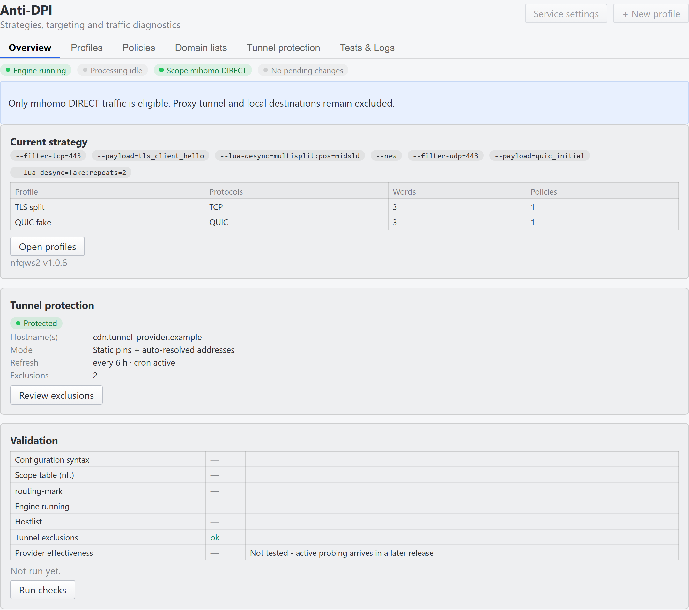
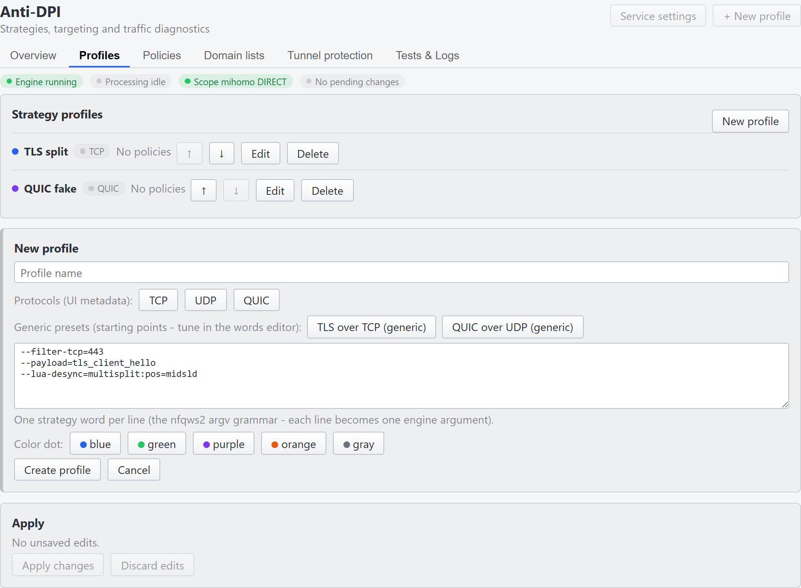
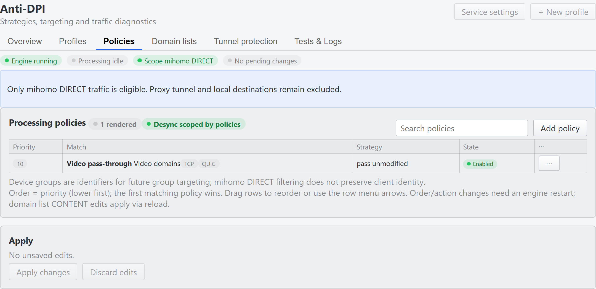

# wanguard-antidpi

**Anti-DPI add-on for OpenWrt routers** - the nfqws2 (zapret2) desynchronization
engine applied only to mihomo DIRECT egress, as a companion to
[wanguard](https://github.com/sers88/wanguard). Traffic already leaving through
the encrypted proxy tunnel is out of scope (excluded by destination address);
the engine sees the packets a DPI middlebox can still inspect.

Status: implemented and accepted end to end - the ucode-first base (#67),
the pinned nfqws2 (zapret2) payload, the mihomo scope integration (#60),
the final scope table (#61), the tunnel exclusion updater (#62), the test
matrix as the release gate (#63), desync strategy tuning with the
engine-level tunnel exclusion (#64), and router acceptance including a
full uninstall / restore cycle (#65). The engine ships in a **graceful
no-op** state; desync strategies are provider-specific by nature and are
configured per router (see Tuning below). The same feed ships a **LuCI
web interface** (issues #75-#88) - strategy profiles, processing
policies, domain lists, tunnel protection and diagnostics, all over the
CLI surfaces (see the section below).

**Language policy: ucode-first** (issue #67) - all router-side logic lives in
a ucode CLI over a UCI config (`/etc/config/wanguard-antidpi`); POSIX sh
remains only for the thin init shim (rc.common contract) and host/CI
tooling. See [docs/ARCHITECTURE.md](docs/ARCHITECTURE.md).

**mihomo routing-mark integration** (issue #60) - on service start the CLI
idempotently injects one root-level line `routing-mark: 268435456` into the
mihomo config (with a backup, `mihomo -t` validation and a live REST reload
when mihomo is running; a foreign `routing-mark` value is never touched).
The mark makes ALL mihomo egress visible to the add-on's nft table - this is
the scope primitive the whole add-on is built around. Removal is explicit
and sticky (see Rollback).

**Tunnel exclusion** (issue #62) - the proxy tunnel itself is never
desynchronized: destinations rendered into the nft set `proxy_servers` bypass
the queue. The set is maintained in UCI (never edited live in nft - an apply
rebuilds the table): static pins in `tunnel.proxy_servers` plus the
resolver-managed `tunnel.proxy_resolved`, refreshed by
`wanguard-antidpi tunnel-update` on every service start and periodically via
cron. Configure your tunnel hostname(s) in `tunnel.tunnel_hosts` and the
updater does the rest:

```
config tunnel 'tunnel'
	list tunnel_hosts 'cdn.tunnel-provider.example'   # your tunnel host(s)
	option update_interval '6'                        # cron hours (0 = manual)
	option expire_hours '24'                          # drop stale IPs after
```

The updater resolves every host with `nslookup`, keeps ALL observed A
records (round-robin/rotating answers are the norm - one query rarely
returns every address), and ages entries out after `expire_hours` without a
fresh answer. If no host resolves (DNS outage), the last known set is kept
untouched. Manual controls: `tunnel-update` (one refresh now),
`tunnel-status` (current state), `cron-install` / `cron-remove` (periodic
trigger). The rendered set = static pins UNION resolver answers, deduped and
sorted; entries are validated as canonical IPv4/CIDR at render time.
Defense in depth for a later phase (#64): desync strategy filters in
`nfqws2_opt` must be written so they only ever match non-tunnel traffic -
the nft-level destination exclusion is the primary control and must not be
the only one.

## Design constants

Published up front (they appear in nft rules and diagnostics; not secrets):

| Constant | Value | Meaning |
|---|---|---|
| Routing mark (mihomo scope) | `0x10000000` | set via mihomo `routing-mark`; only this traffic enters the add-on |
| DESYNC_MARK | `0x40000000` / `0x20000000` | nfqws per-packet strategy marks |
| NFQUEUE number | `300` | bypass queue for desynchronized packets |
| nft table | `inet wanguard_antidpi` | own table; never touches wanguard / fw4 tables |
| connbytes windows | tcp 443 `1-20`, udp 443 `1-5` | only the start of every connection enters the queue (zapret2 config.default) |

### Compatibility contract

Who owns what, and what this add-on never touches (consolidated contract;
details in [docs/ARCHITECTURE.md](docs/ARCHITECTURE.md), section 5):

- **owned by this add-on**: fwmark `0x10000000` (the mihomo `routing-mark`
  scope mark), fwmark `0x40000000` (nfqws2 strategy mark, `engine.fwmark`),
  NFQUEUE `300` (`engine.qnum`), the own nft table `inet wanguard_antidpi`,
  and the machine-managed engine hostlist
  `/usr/share/wanguard-antidpi/whitelist.hosts` (rendered from UCI, removed
  when whitelist mode is off);
  fwmark `0x20000000` stays reserved for blockcheck2 staging runs (its
  hardwired `DESYNC_MARK` must be patched away from `0x10000000` - see
  Tuning)
- **never written by this add-on**: the `inet wanguard` and `inet fw4`
  tables, policy routing (`ip rule`) - proven by the acceptance uninstall
  audit (#65): both foreign tables byte-identical, `ip rule` untouched
- **foreign files edited** (exactly two, both reversible):
  `/etc/mihomo/config.yaml` - one idempotent root-level `routing-mark`
  line (backup + `mihomo -t` validation + live REST reload + restore on
  remove), and `/etc/crontabs/root` - one tagged cron line (foreign lines
  preserved; dropped on service stop)

## Installation

### Via the signed apk feed

The feed is published by CI to the [`feed`](https://github.com/sers88/wanguard-antidpi/tree/feed)
branch on a `vX.Y.Z` tag push (packages get version `X.Y.Z-r1`). The
`packages.adb` index is signed with an EC key; the public key is
[`keys/wanguard-antidpi.pem`](keys/wanguard-antidpi.pem).

On the router (OpenWrt 24.10+/25.x, apk 3.0.x):

```sh
# 1. trust the feed key
curl -o /etc/apk/keys/wanguard-antidpi.pem \
  https://raw.githubusercontent.com/sers88/wanguard-antidpi/feed/keys/wanguard-antidpi.pem

# 2. add the feed
echo "https://raw.githubusercontent.com/sers88/wanguard-antidpi/feed/packages/x86_64/packages.adb" \
  >> /etc/apk/repositories.d/customfeeds.list

# 3. install
apk update
apk add wanguard-antidpi luci-app-wanguard-antidpi
```

### Install combinations (issue #78)

One tag ships both packages at the same version; they are independent in
both directions (the LuCI app does NOT depend on luci-app-wanguard):

| Installed | Result |
|---|---|
| core only | no LuCI integration; everything via the CLI |
| core + `luci-app-wanguard` | WAN Guard menu; the Anti-DPI tab arrives with `luci-app-wanguard-antidpi` |
| core + `luci-app-wanguard-antidpi` | standalone WAN Guard menu with a single Anti-DPI tab |
| all three | WAN Guard menu with the full tab set plus Anti-DPI |

`apk del luci-app-wanguard-antidpi` removes the Anti-DPI tab and nothing
else (the core package keeps running).

Feed caching: the `packages.adb` index is served through GitHub's CDN and
can lag the published `feed` branch by ~5-10 minutes. If `apk update` right
after a release does not show the new version yet, wait and retry - do not
work around it with query strings in the feed URL (apk concatenates the
repository URL with package names, which corrupts the fetch). `apk
upgrade` never downgrades, so a stale index cannot roll a newer install
back.

## LuCI web interface (issues #75-#88)

The feed ships `luci-app-wanguard-antidpi`, a single page under
**Network -> WAN Guard -> Anti-DPI** with six sub-tabs:

| Tab | What it manages |
|---|---|
| Overview | the live strategy (profile blocks derived from the rendered engine argv), tunnel-protection status, validation checks, the pending-changes bar |
| Profiles | named strategy profiles (desync words, one engine `--new` block each), order/color metadata, generic presets |
| Policies | ordered match -> action rules: a domain list + protocols route to a strategy profile, pass unmodified, or nothing (first match wins) |
| Domain lists | the SNI lists policies match on, and the desync mode (blanket / whitelist) |
| Tunnel protection | the exclusion set - static pins, updater hosts, refresh/expiry intervals: what the nft table and the engine never desynchronize |
| Tests & Logs | queue counters with a per-tick delta, `apply --check` validation, the engine verbose-logging toggle, a filtered syslog tail |

Everything on the page reads from ONE `wanguard-antidpi status --json`
call per refresh; the heavier probes (`apply --check`, `apply`, the log
fetch) run strictly on demand behind their buttons. Editors stage changes
client-side - nothing reaches the router until you apply. The pending
bar's **Review & Apply** commits the staged UCI and then runs the
idempotent `apply` orchestration, whose engine step restarts the service
only when the engine argv actually drifts: domain-list content edits
apply via SIGHUP without dropping live connections, strategy/profile/
policy structure edits restart the engine. The badges say so up front:
"apply restarts the engine", "metadata only", "applies via reload -
live connections stay up".

A missing or pre-`status` CLI (old package, denied ACL) renders an
"unavailable - update the package" section with muted chips instead of
breaking the page; it recovers in the poll loop without a reload, and
partial degradations surface from the status document's `degraded` map.
Install combinations (core only / with `luci-app-wanguard` / standalone)
are in the Installation section; the menu merge contract and the full
UI<->CLI contract live in [docs/ARCHITECTURE.md](docs/ARCHITECTURE.md),
section 7.





The Profiles drawer ships two **generic presets** - starting points, not
tuned strategies (see the provider-specificity note in Tuning): **TLS
over TCP** (`--filter-tcp=443 --payload=tls_client_hello
--lua-desync=multisplit:pos=midsld`) and **QUIC over UDP**
(`--filter-udp=443 --payload=quic_initial --lua-desync=fake:repeats=2`).
Both follow the mandatory-word rules from Tuning, start the pinned engine
byte-exactly in `tests/test-profiles.sh`, and are pinned in
`tests/test-luci.sh` so the presets, the README and the tests stay in
sync. Applying a preset onto a profile that already has words is a
two-step confirmation - no silent overwrite. Policies can exempt
incompatible origins from desync entirely (a `pass unmodified` policy
outranks the catch-all strategy):



The remaining tabs:

- [Domain lists](docs/screenshots/domain-lists.png) - desync mode card,
  per-list editors with inline validation, two-step deletes;
- [Tunnel protection](docs/screenshots/tunnel-protection.png) -
  protection status, the committed exclusion set (pins + resolver
  answers with expiry), the staged editor;
- [Profiles](docs/screenshots/profiles.png) - the profile list with
  protocol badges derived from the words and the policy-ref delete
  guard;
- [Tests & Logs](docs/screenshots/tests-and-logs.png) - queue counters
  (the same delta the header chip reads), validation, verbose logging,
  the syslog tail.

The screenshots are rendered by the actual package view code (the same
code the CI view tests execute) in a headless browser with documentation
example data (RFC 2606 hostnames, RFC 5737 addresses) - not captured
from a production router.

## Package contents

| Path | What |
|---|---|
| `/usr/bin/nfqws2` | static desync engine from the pinned upstream zapret2 release (shipped unmodified) |
| `/usr/bin/wanguard-antidpi` | control CLI (**ucode**, `router/wanguard-antidpi.uc`): version, engine command line, nft render/apply/flush, mihomo mark install/remove/status, tunnel resolver updater (`tunnel-update`/`tunnel-status`) and its cron schedule (`cron-install`/`cron-remove`), whitelist render/reload/status, `apply [--check]` (idempotent orchestration for the LuCI page), `status [--json]` (read-only state surface) and `events [--filter=F] [--tail=N]` (read-only syslog tail for the Tests & Logs tab: filter = engine\|nfqws2\|antidpi\|mihomo, tail clamped to [1, 200] - filtering and the bound run on the router); all state-changing commands are DRYRUN-aware |
| `/usr/share/wanguard-antidpi/lua/zapret-lib.lua.gz` | upstream lua library (gzipped lua is supported natively by nfqws2) |
| `/usr/share/wanguard-antidpi/lua/zapret-antidpi.lua.gz` | upstream desync strategy functions |
| `/usr/share/wanguard-antidpi/wanguard-antidpi.nft` | scope table template (`@QNUM@`, `@FWMARK@`, `@PROXY_ELEMENTS@` rendered from the config by `nft-render`; includes the pre-CR conntrack notrack for engine packets, #68) |
| `/usr/share/wanguard-antidpi/version` | package version stamp |
| `/etc/config/wanguard-antidpi` | UCI config template (source of truth; apk-protected: user edits survive upgrades) |
| `/etc/init.d/wanguard-antidpi` | procd init (thin sh shim - the rc.common contract): ensure mihomo mark -> refresh tunnel exclusion set (non-fatal) -> apply own nft table -> ensure the periodic-update cron line -> engine instance (respawn on crash); stop = kill -> drop cron line -> flush table |

### luci-app-wanguard-antidpi (issue #78)

| Path | What |
|---|---|
| `/usr/share/luci/menu.d/wanguard-antidpi.json` | menu nodes: the `admin/network/wanguard` parent (replicating luci-app-wanguard's node so the menu works standalone, ACL switched to this package's group) + the `admin/network/wanguard/antidpi` child. The FILE NAME is part of the contract: `wanguard-antidpi.json` sorts after `luci-app-wanguard.json` in menu.d glob order, so the real node wins the per-field merge against the placeholder (#75); the default package-derived name sorts before it and would lose |
| `/usr/share/rpcd/acl.d/luci-app-wanguard-antidpi.json` | ACL group `luci-app-wanguard-antidpi`: exec `/usr/bin/wanguard-antidpi`, read/write the `wanguard-antidpi` UCI config, ubus `file` read/exec and the staged-UCI verbs (`uci` add/set/delete/order + apply/confirm/revert/get/changes) |
| `/www/luci-static/resources/view/wanguard/antidpi.js` | the page view (thin: header, tab bar, poll wiring) |
| `/www/luci-static/resources/wanguard-antidpi/core.js` | the shared core module behind all six sub-tabs (the luci-app-wanguard pattern: a LuCI class facade over the page state) |

Upstream pinning (issue #57): the engine payload comes from the
`bol-van/zapret2` `openwrt-embedded` release artifact, downloaded at build
time by `scripts/fetch-upstream.sh` and verified against two pinned sha256
values - the artifact itself and the canonical
`binaries/linux-x86_64/nfqws2` hash from the upstream `sha256sum.txt`.
Nothing else from the artifact is packaged: the add-on owns the lifecycle
(its own init/nft/config); upstream's installer, init scripts and firewall
mechanics are not used. `ip2net`/`mdig` and `zapret-auto.lua.gz` are deferred
until the hostlist/autohostlist phase.

The package major version tracks the upstream engine version: release tag
`v1.0.6` produces package `1.0.6-r1` (CI fails a tag that does not equal the
pinned `ZAPRET2_VERSION_DEFAULT`). Package-only fixes (without an upstream
bump) ship as an explicit revision tag: `v1.0.6-r2` produces `1.0.6-r2`.
Engine lifecycle notes:

- graceful no-op: with the strategy list empty (`nfqws2_opt`, the default until
  blockcheck tuning) the engine starts, binds the queue and passes packets
  unmodified; without mihomo running, no packet carries the scope mark, the
  queue stays empty (`bypass`), and the init logs a hint to logread
- tunnel exclusion: the `proxy_servers` set is rendered from the UCI lists
  (`tunnel.proxy_servers` static pins + `tunnel.proxy_resolved` maintained
  by the resolver updater, issue #62) on every apply. With tunnel hosts
  configured the updater fills the set automatically; until then the tunnel
  itself matches the queue - keep the strategy list empty, or
  desynchronizing the tunnel's own TLS would break it
- `bypass` queue semantics: if the engine dies, marked packets leave
  unprocessed instead of dropping (procd respawns it meanwhile)
- DRYRUN contract: `WANGUARD_ANTIDPI_DRYRUN=1` makes the init/CLI print
  actions without touching live state - this is what the container test
  matrix exercises

## Rollback

- stop the add-on only (engine killed, nft table flushed; the mihomo
  routing-mark stays in its config BY DESIGN - it is harmless without the
  queue rules):

  ```sh
  /etc/init.d/wanguard-antidpi stop && /etc/init.d/wanguard-antidpi disable
  ```

- remove the mark and restore the mihomo config (backup taken at install
  time, or the injected line dropped surgically when no backup exists);
  also disarms the init hook so a later service start does not re-inject:

  ```sh
  wanguard-antidpi mark-remove
  ```

  NB: backup-restore reverts any mihomo config edits made between
  `mark-install` and `mark-remove` - re-apply those edits afterwards if any.
  Re-enable the integration later with `wanguard-antidpi mark-install`;
  current state: `wanguard-antidpi mark-status`.

- remove the package (`apk del wanguard-antidpi`); run `mark-remove` first
  if the mihomo config should be restored - apk has no uninstall hooks.
  A stopped service leaves no periodic updater behind (stop drops the cron
  line); `/usr/share/wanguard-antidpi/tunnel-resolved.state` (per-IP
  timestamps of the resolver answers) is an unowned leftover file and can be
  removed together with the package.

Note on licensing: this repository's own code is MIT. The upstream engine
zapret2 does not declare a license; its binary and lua strategies are
redistributed here unmodified, pinned by sha256.

## Tuning desync strategies (issue #64)

The engine ships in a **graceful no-op** state: the UCI list
`wanguard-antidpi.engine.nfqws2_opt` is empty, nfqws2 passes packets through
untouched. Desync strategies are configured by filling that list - **one list
item = one nfqws2 argv word** - and restarting the service:

```sh
uci add_list wanguard-antidpi.engine.nfqws2_opt='--filter-tcp=443'
uci add_list wanguard-antidpi.engine.nfqws2_opt='--payload=tls_client_hello'
uci add_list wanguard-antidpi.engine.nfqws2_opt='--lua-desync=multisplit:pos=midsld'
uci commit wanguard-antidpi
/etc/init.d/wanguard-antidpi restart
```

Rollback: `uci delete wanguard-antidpi.engine.nfqws2_opt; uci commit
wanguard-antidpi` and restart - the engine returns to the no-op.

Things that hold for ANY strategy on this add-on:

- **`--payload=<type>` is mandatory** before a chain of `--lua-desync=...`
  functions. Without it the lua functions receive no packet types and the
  whole chain is silently inert (engine runs, CPU stays at zero, traffic is
  unchanged). Canonical types: `tls_client_hello` (TCP), `quic_initial`
  (UDP), `http_req` (plain HTTP). `--filter-tcp=443` / `--filter-udp=443`
  scope each chain to its protocol.
- **Tunnel destinations are excluded at the engine level too** (defense in
  depth, issue #64): the engine argv automatically carries
  `--ipset-exclude-ip=<merged tunnel set>` whenever the tunnel lists are
  populated - the same validated, deduped, sorted set the nft table
  excludes. Even if a rotated tunnel address reaches the queue before the
  nft set updates, desync never touches tunnel traffic. This is rendered by
  `wanguard-antidpi engine-cmdline` and needs no configuration.
- The nft table gates what reaches the queue at all: mihomo DIRECT egress
  (routing mark), tcp/udp 443 only, first packets of a connection
  (connbytes 20/5), destination outside the local networks and the tunnel
  sets.

**Finding a strategy that works for YOUR provider** is provider-specific by
nature - a strategy tuned on one ISP's DPI commonly fails on another. The
upstream `blockcheck2.sh` (zapret2 repository, same version tag as the
pinned engine) automates the search: run it ON the router, it tests dozens
of strategy variants against blocked domains of your choice through its own
temporary nft table and queue, and prints which ones worked. Practical
notes from tuning this add-on:

- stage the whole upstream tree in `/tmp` (blockcheck2.sh, `blockcheck2.d/`,
  `common/`, `config.default`, lua copies; the openwrt-embedded engine
  tarball has no `mdig` binary - a small nslookup-based stub satisfies
  blockcheck2's resolve paths);
- pass `QNUM=<free queue> BATCH=1 SKIP_DNSCHECK=1 SKIP_IPBLOCK=1
  ENABLE_HTTP=0` and `NFQWS2=/usr/bin/nfqws2`;
- **WARNING: blockcheck2 hardwires `DESYNC_MARK=0x10000000`.** If other
  software on the router already uses that fwmark (this add-on's mihomo
  integration does), patch the staging copy to a free bit before running -
  otherwise blockcheck's notrack rules hit that traffic too;
- run it per egress path you want to cover, keep unblocked control sites in
  the loop (some foolings - notably `tcp_md5` - break servers that never
  asked for them), and prefer strategies that survive on **all** your paths
  and leave the controls working.

## Whitelist mode (issue #70)

By default the add-on desyncs **every** queued target (blanket mode). The
whitelist flips the model: desync is applied **only to the listed hosts** -
SNI-based, subdomains auto-apply, so CDN address rotation is irrelevant:

```sh
uci set wanguard-antidpi.whitelist=whitelist
uci set wanguard-antidpi.whitelist.enabled='1'
uci add_list wanguard-antidpi.whitelist.domains='example.org'
uci add_list wanguard-antidpi.whitelist.domains='example.net'
uci commit wanguard-antidpi
/etc/init.d/wanguard-antidpi restart
```

List changes afterwards do not need a restart:

```sh
uci add_list wanguard-antidpi.whitelist.domains='example.com'
uci commit wanguard-antidpi
wanguard-antidpi whitelist-reload
```

`whitelist-reload` re-renders the hostlist file and signals the running
engine (SIGHUP) to re-read its lists - the queue and live connections are
untouched (verified against the pinned binary; there is no automatic mtime
reload).

Semantics and guardrails:

- `enabled=0` or a missing `whitelist` section = blanket mode (the classic
  behavior); the hostlist file is removed.
- Strict DNS names only - no wildcards (suffix matching already covers
  subdomains), no commas/spaces. Garbage entries are rejected loudly at
  render time: both `whitelist-refresh` and `engine-cmdline` fail.
- While enabled, the rendered hostlist is a **hard engine dependency**:
  nfqws2 refuses to start without the file, and `enabled=1` with an empty
  domain list is rejected at render time - a half-enabled config fails
  loudly instead of silently falling back to blanket desync.
- The hostlist binds per engine profile: `--hostlist` is re-emitted after
  every `--new` strategy separator, so the whitelist constrains all profiles
  of a multi-profile strategy.
- Whitelist mode constrains the DESYNC only. The nft scope (scope mark, tcp/
  udp 443, connbytes, tunnel/local exclusions) is unchanged - the queue still
  sees the same packets, the engine passes non-whitelisted ones through
  unmodified.

Status: `wanguard-antidpi whitelist-status` (enabled / domains / file /
engine argv / engine pid).

Rollback to blanket mode: `uci set wanguard-antidpi.whitelist.enabled='0';
uci commit wanguard-antidpi; /etc/init.d/wanguard-antidpi restart` - the
restart re-renders the argv without `--hostlist` and removes the file.
`whitelist-reload` alone cannot switch modes: it updates list content while
whitelist mode stays enabled.

## Policies (issue #86)

Policies are ordered **match -> action** rules rendered as the FIRST engine
profile blocks, ahead of the global strategy (the first match wins - nfqws2
profile semantics). Each rule scopes a domainlist to a protocol and routes
the matched traffic to a strategy profile, a pass-through, or nothing:

```sh
# the match scope: a named domain list (section name = the stable id)
uci set wanguard-antidpi.list_media=domainlist
uci set wanguard-antidpi.list_media.name='Video domains'
uci add_list wanguard-antidpi.list_media.domains='example.org'
uci add_list wanguard-antidpi.list_media.domains='example.net'

# a strategy profile (desync words; see "Tuning desync strategies")
uci set wanguard-antidpi.prof_balanced=profile
uci set wanguard-antidpi.prof_balanced.name='Balanced'
uci add_list wanguard-antidpi.prof_balanced.strategy_words='--filter-tcp=443'
uci add_list wanguard-antidpi.prof_balanced.strategy_words='--payload=tls_client_hello'
uci add_list wanguard-antidpi.prof_balanced.strategy_words='--lua-desync=multisplit:pos=midsld'

# the policy: media traffic passes UNMODIFIED, everything else keeps the
# global strategy (the engine.nfqws2_opt list or the other profiles)
uci set wanguard-antidpi.pol_video=policy
uci set wanguard-antidpi.pol_video.name='Video traffic'
uci set wanguard-antidpi.pol_video.priority='10'
uci set wanguard-antidpi.pol_video.domainlist='list_media'
uci set wanguard-antidpi.pol_video.proto='tcp quic'
uci set wanguard-antidpi.pol_video.action='bypass'
uci commit wanguard-antidpi
/etc/init.d/wanguard-antidpi restart
```

Actions: `strategy` (the referenced profile's desync words ride in the
policy block - refs go by the profile SECTION name), `bypass` (filters plus
the list, no desync functions: the engine passes the matched traffic
unmodified), `none` (no block; the traffic falls through to the global
strategy, the policy stays validated loudly).

Semantics and guardrails:

- Order = `option priority` ascending (step 10 is the convention; ties keep
  the section file order). The FIRST matching block wins, so a bypass
  policy ahead of the catch-all effectively exempts its traffic.
- `option proto` drives the block filters: `tcp` -> `--filter-tcp=443`
  (`tls_client_hello` payload), `udp`/`quic` -> `--filter-udp=443`
  (`quic_initial` payload). For `strategy` policies the referenced profile's
  own `--filter-*`/`--payload` words are excluded from the block - one
  filter source per block.
- While any policy renders a block, the whitelist binding (#70) is IGNORED
  (warned on every render): the blocks own their per-list hostlists, and
  whitelist mode is the single-policy special case of the same idea.
- `whitelist-refresh` renders one hostlist file per referenced list
  (`/usr/share/wanguard-antidpi/lists/<list>.hosts`, deduped + sorted,
  0644). A missing file keeps the engine from starting (#70 contract); the
  init shim refreshes before every start.
- Validation is loud and named: unknown action, missing/unknown domainlist
  or profile ref, empty or unknown proto tokens all fail the render.
  Disabled policies skip validation entirely (the profiles spare exit).
- Tunnel/proxy exclusions stay ABOVE every policy: the nft set and the
  engine `--ipset-exclude-ip` still fire first - only mihomo DIRECT traffic
  is ever eligible for desync or bypass.
- `option device_group` is stored for future group targeting and ignored by
  the current render (no client identity survives in the queue).
- A policy argv change (add/remove/order/action/filters) needs an engine
  restart; editing a list's DOMAINS only needs `whitelist-reload` (SIGHUP
  re-reads the file content).

Status: `wanguard-antidpi status` carries `engine.policies` (rendered block
count) and `engine.policy_sections` (id/name/priority/domainlist/proto/
action/profile/enabled) for the LuCI page.

The LuCI page (Network -> WAN Guard -> Anti-DPI -> Policies, issue #87)
manages the same sections: the Processing policies table (Priority / Match /
Strategy / State columns, drag-to-reorder with row-menu arrow fallback -
reorders renumber priorities in the step-10 convention), an Edit-policy
drawer (name, device group - stored but ignored by the render until the
queue learns client identity, domain list, protocols, action, strategy
profile, advanced priority override), inline validation before staging
(unknown list/profile refs are named errors, never staged), and honest
apply badges: order/action/protocol/ref/enabled edits restart the engine,
name/device-group edits are metadata-only, and domain-list content edits
apply via reload (SIGHUP). Referenced domain lists cannot be deleted from
the Domain lists tab until the policies referencing them are unlinked.

## Operations

- **status / diagnostics**: `wanguard-antidpi mark-status` (mihomo
  integration facts), `tunnel-status` (exclusion set + cron),
  `whitelist-status` (SNI whitelist state), `engine-cmdline`
  (the exact nfqws2 argv), `version` / `engine-version`. Any state-changing
  command accepts `WANGUARD_ANTIDPI_DRYRUN=1` to print actions without
  touching live state.
- **status surface (issue #76)**: `wanguard-antidpi status [--json]` - the
  whole read-only state (service / engine / nft counters / tunnel entries /
  whitelist / mihomo mark / pending UCI delta / syslog tail) in ONE call for
  the LuCI page. `--json` emits a single JSON document with stable keys;
  every unavailable surface degrades explicitly (null data + an entry in
  the `degraded` map) instead of failing - the page renders its
  "unavailable" states from the same keys. Read-only by design.
- **apply (issue #77)**: `wanguard-antidpi apply [--check] [--json]` - the
  idempotent orchestration point: mark-ensure -> tunnel-update -> nft-apply
  -> whitelist-refresh -> engine. The engine step decides restart-vs-SIGHUP
  from evidence: list content changes re-read on SIGHUP without dropping
  the queue or live connections; strategy word changes restart through the
  init script (which re-runs the same idempotent steps). Repeated apply
  without config changes is a no-op. Exit codes: 0 ok, 1 validation
  failure, 2 partial (a non-fatal step kept a fallback - e.g. tunnel-update
  kept the last known exclusion set). `--check` is a read-only preflight
  (config renders, nft table in force, mark installed with our value,
  engine running, hostlist present when consumed) with a human report or
  `--json`. DRYRUN prints the plan without touching live state.
- **events (issue #88)**: `wanguard-antidpi events [--json]
  [--filter=engine|nfqws2|antidpi|mihomo] [--tail=N]` - the Tests & Logs
  log viewer's surface. Same syslog tail as the status events (engine =
  the `nfqws2|wanguard-antidpi` grep, 20-line default there), with the
  UI's filter choice and a UI-chosen tail clamped to [1, 200] (default
  50). Filtering and the bound run on the router - the browser never
  pulls the raw ring buffer. Degraded (`available=false`) when no syslogd
  is running.
- **engine debug logging**: `uci set wanguard-antidpi.engine.debug='1'; uci
  commit wanguard-antidpi; /etc/init.d/wanguard-antidpi restart` - nfqws2
  then runs with `--debug=1` and logs per-packet verdicts to syslog
  (`logread | grep nfqws2`). Verbose by design; meant for tuning sessions -
  turn it back off with `'0'`. The LuCI Tests & Logs tab (issue #88) flips
  the same option through the staged pipeline (the flag rides the engine
  argv, so a flip is an engine restart) and shows the log tail with the
  filters above; the queue-counters card measures the per-tick delta -
  the same window the header's "Processing active" chip reads.
- **exclude a destination from desync manually**: static pins go to
  `tunnel.proxy_servers` (canonical IPv4/CIDR each), then restart the
  service - the merged set (static pins + resolver answers) is re-rendered
  into the nft set, and the engine argv re-renders its
  `--ipset-exclude-ip`:

  ```sh
  uci add_list wanguard-antidpi.tunnel.proxy_servers='203.0.113.10'
  uci commit wanguard-antidpi
  /etc/init.d/wanguard-antidpi restart
  ```

- **temporarily disable processing** without uninstalling: see Rollback
  (stop + disable; the scope mark stays in the mihomo config and is
  harmless without the queue rules).

## Development

All development and testing runs in Docker containers - the same
`openwrt/rootfs:x86_64-25.12.6` image CI uses; the router is only touched at
final acceptance. One command from zero to the full test matrix:

```sh
sh scripts/dev-test.sh            # kernel probe -> build -> smoke -> mark -> nft -> tunnel
sh scripts/dev-build.sh 0.1.2-r1  # build only -> out/*.apk
sh scripts/kernel-probe.sh        # NFQUEUE capability probe only
```

On Windows run these from the **Git Bash** shell (the scripts are POSIX sh;
outside Git Bash, `bash` may resolve to WSL and `sh` may not be on PATH - the
scripts handle Git Bash path-mangling quirks themselves).

What runs where:

- `scripts/dev-build.sh` - fetches the pinned upstream engine payload
  (`scripts/fetch-upstream.sh`, sha256-pinned) and the pinned `apk.static`
  (same pins as CI), then builds `out/*.apk` inside the container. Packages
  are intentionally unsigned; the feed index signature is what routers
  verify.
- `scripts/kernel-probe.sh` - tries an `nft ... queue num 300 bypass` rule in
  a container. Containers use the **host kernel** (on Windows: the Docker
  Desktop / WSL2 VM kernel), so the verdict describes the machine, not the
  image: `NFQUEUE-OK` means live packet scenarios are testable in containers
  here; `NFQUEUE-UNAVAILABLE` (never fatal) means container tests stay
  structural/dry-run and live desync scenarios are validated only at router
  acceptance.
- `scripts/dev-test.sh` - probe, build, then the whole test matrix in fresh
  containers, one command; exits non-zero on failure.
- `tests/container-smoke.sh` - install + smoke matrix inside the container,
  two modes: `local` (untrusted install of `out/*.apk`, used by
  `dev-test.sh` and CI `smoke-test`) and `feed` (signed feed install, used
  by CI `feed-test`). One script for both modes, so local and CI results are
  comparable by construction. Covers file layout, the version stamp,
  structural render/DRYRUN contracts and the conffile contract.
- `tests/test-mark.sh` - mihomo routing-mark integration test with a REAL
  pinned mihomo binary inside the container (needs `--cap-add NET_ADMIN`):
  `mihomo -t` after the inject, start with the mark, live REST reload in both
  directions, idempotency, conflict, DRYRUN, graceful no-config.
- `tests/test-nft.sh` - the final scope table, live (needs
  `--cap-add NET_ADMIN`): apply shape + re-apply idempotency, BYPASS
  (engine down -> marked traffic flows), engine queue bind, scope negatives
  (unmarked traffic never ticks the counters), flush. Uses the same pinned
  mihomo as the marked traffic source; on a kernel without NFQUEUE it stays
  structural (`NFT-LIVE-SKIP`).
- `tests/test-tunnel.sh` - the tunnel exclusion resolver updater, live
  (needs `--cap-add NET_ADMIN`, no network: DNS answers come from a stub
  `nslookup` on PATH): multi-A resolution into the sorted UCI list,
  idempotency (config bytes untouched), cross-host dedupe, partial and total
  resolution failures, per-IP expiry, live apply with a populated set,
  update-while-live, no-table guard, render-injection guard; without NFQUEUE
  in the host kernel the live apply part stays structural
  (`TUNNEL-LIVE-SKIP`).
- `tests/test-luci.sh` - the LuCI menu + ACL matrix (issue #78; needs the
  network for the `luci-base` dependency): install both packages, dispatcher
  fidelity guard (the merge/ACL harness in `tests/luci-menu-test.uc`
  replicates the installed dispatcher verbatim - the pinned lines in
  `tests/luci-dispatcher-lines.txt` must exist in it), parent-node golden
  guard against the `luci-app-wanguard` fixture, child-node completeness,
  sort-order probes (both the winning name and the losing default name),
  merged / standalone / read-only / ACL-negative tree scenarios, the
  byte-identical-parent deviation proof, the live install matrix
  (issue #89: antidpi-only -> both -> wanguard-only after `apk del`) and
  the `apk del` behavior.
- `tests/luci/run-tests.js` - the LuCI view tests (issue #89; runs with
  plain `node`, no router involved): the REAL view + core module from the
  package are evaluated in node with stubbed LuCI globals (`view` / `poll`
  / `rpc` / `uci` / `ui` / `E`), covering every sub-tab - the #81 overview
  cards and the pending-bar apply pipeline, #82 domain lists staging,
  #83 tunnel editors, #84/#85 profiles (presets, honest badges, reorder),
  #86/#87 policies (ref validation before staging, drag priority,
  metadata-only vs restart badges) and #88 tests & logs (counter delta,
  debug toggle, log viewer degradations). CI runs the same file in the
  same `node:24` container (`view-test` job / `dev-test.sh` step 13).

### Test matrix = release gate (issue #63)

The same `tests/*.sh` scripts run locally (`scripts/dev-test.sh`, one
command) and in CI; a red matrix blocks publication - the `publish` job
needs every matrix job green:

| Slice | Script | What it proves |
|-------|--------|----------------|
| Install | `tests/container-smoke.sh` (local + feed modes) | `apk add` (untrusted artifact / signed feed), file layout, version stamp, conffile contract: a user-modified `/etc/config/wanguard-antidpi` survives a reinstall of the same version, the incoming default lands next to it as `.apk-new` |
| Syntax + DRYRUN | `tests/container-smoke.sh` | `sh -n` on the init script; `nft-apply` / `nft-flush` / `mark-install` / `tunnel-update` / `cron-install` DRYRUN never touch live state (the init shim's DRYRUN paths need `rc.common` - router acceptance only) |
| mihomo integration | `tests/test-mark.sh` | real pinned mihomo: inject -> `mihomo -t` ok -> mihomo starts with the mark; a repeated inject is a no-op; remove restores the original bytes; live REST reload both directions |
| nft table | `tests/test-nft.sh` | apply shape (priority 101, 2 queue rules, both sets, notrack predefrag #68), re-apply byte-identical, bypass with the engine down, engine queue bind, scope negatives, flush |
| Resolver updater | `tests/test-tunnel.sh` | multi-A answers into the sorted UCI list, set-update idempotency, dedupe, partial/total failure behavior, per-IP expiry, live apply/update, no-table guard |
| Graceful no-op | across the matrix | empty strategy + 6-word `engine-cmdline` golden (smoke), marked traffic flows with the engine down (`test-nft.sh` BYPASS), graceful no-mihomo-config paths (`test-mark.sh`, smoke) |
| LuCI menu + ACL | `tests/test-luci.sh` | both packages install (luci-base dependency resolves), dispatcher fidelity guard, parent-node golden guard (fixture) + child completeness, sort-order (winning + losing name), merged/standalone/read-only/acl-negative trees, byte-identical-parent deviation proof, the live install matrix - antidpi-only (one real tab) / both (real node wins the placeholder) / wanguard-only (stub tab, page files gone after `apk del`), `apk del` removes the tab only |
| LuCI views | `tests/luci/run-tests.js` (node) | the real view + core evaluated with stubbed LuCI globals: every sub-tab covered (overview cards + apply pipeline, domain lists, tunnel, profiles, policies, tests & logs), staging never happens on invalid input, honest badges (restart vs reload vs metadata-only), poll ticks never rebuild editor tabs, degraded surfaces stay alive |

Known limitation: live NFQUEUE scenarios (real packets processed through the
queue) cannot run in a container whose host kernel lacks queue support - on
such hosts the matrix stays structural (`NFT-LIVE-SKIP` /
`TUNNEL-LIVE-SKIP`) and those cases are covered by router acceptance.

CI pipeline (`feed.yml`): `build` (one tag = both packages, guard asserted) ->
matrix (`smoke-test`, `mark-test`, `nft-test`, `tunnel-test`, `status-test`,
`apply-test`, `luci-test`, `view-test` in parallel) -> `publish` (sign the
index, push the `feed` branch; tag pushes only) -> `feed-test` (install from
the live feed as the final canary; cannot precede publication by definition -
the matrix already install-tested the same artifact before it was published).
A separate scheduled workflow (`upstream-watch.yml`) checks the upstream pin
daily and opens the pin-bump PR when a new stable `zapret2` release appears
(both hashes computed from the release artifact and cross-checked against the
upstream `sha256sum.txt`; the full matrix is dispatched on the bump branch).

### Updating the upstream engine

The pin lives in `scripts/fetch-upstream.sh` as the single source of truth:
`ZAPRET2_VERSION_DEFAULT` plus two sha256 constants (the release tarball
and the canonical `binaries/linux-x86_64/nfqws2` hash from the upstream
`sha256sum.txt`). Bumping the engine:

1. the automated way: `upstream-watch.yml` opens the bump PR within a day of
   the upstream release (pin + both hashes updated, `fetch-upstream.sh`
   re-verified on the full download path, full matrix dispatched on the bump
   branch) - review the upstream changelog against the pinned strategy,
   merge, tag `vX.Y.Z-r1`;
2. the manual way (the fallback, and exactly what the automation does):
   update the pin (version + both hashes) in `scripts/fetch-upstream.sh`,
   then `sh scripts/dev-test.sh` - the build fetches the new artifact,
   verifies both hashes, and the whole matrix must stay green;
3. tag `vX.Y.Z` (package `X.Y.Z-r1`) and push - CI runs the same matrix and
   publishes the feed only on green; a tag that disagrees with the pin
   fails the CI version guard.

Package-only fixes (config/render/tests, no engine change) ship as an
explicit revision tag `vX.Y.Z-rN` without touching the pin. Consumers: the
feed index is CDN-cached (see Installation) - give it a few minutes before
`apk update && apk upgrade` on the router.

## Requirements

- OpenWrt with apk (24.10+/25.x) and mihomo as the proxy core (the add-on
  only ever processes traffic mihomo routes DIRECT)
- kernel NFQUEUE modules for the live engine phases (`kmod-nft-queue`,
  `kmod-nfnetlink-queue`) - declared as package dependencies, pulled from
  the upstream OpenWrt feed unpinned; the nftables userspace is declared too
  (present via fw4 on stock 25.x)
- ucode + `ucode-mod-fs` + `ucode-mod-uci` for the control CLI (from the
  ucode-first base revision onward, issue #67; preinstalled on stock 25.x,
  declared as dependencies like the wanguard core does)

## License

[MIT](LICENSE)
